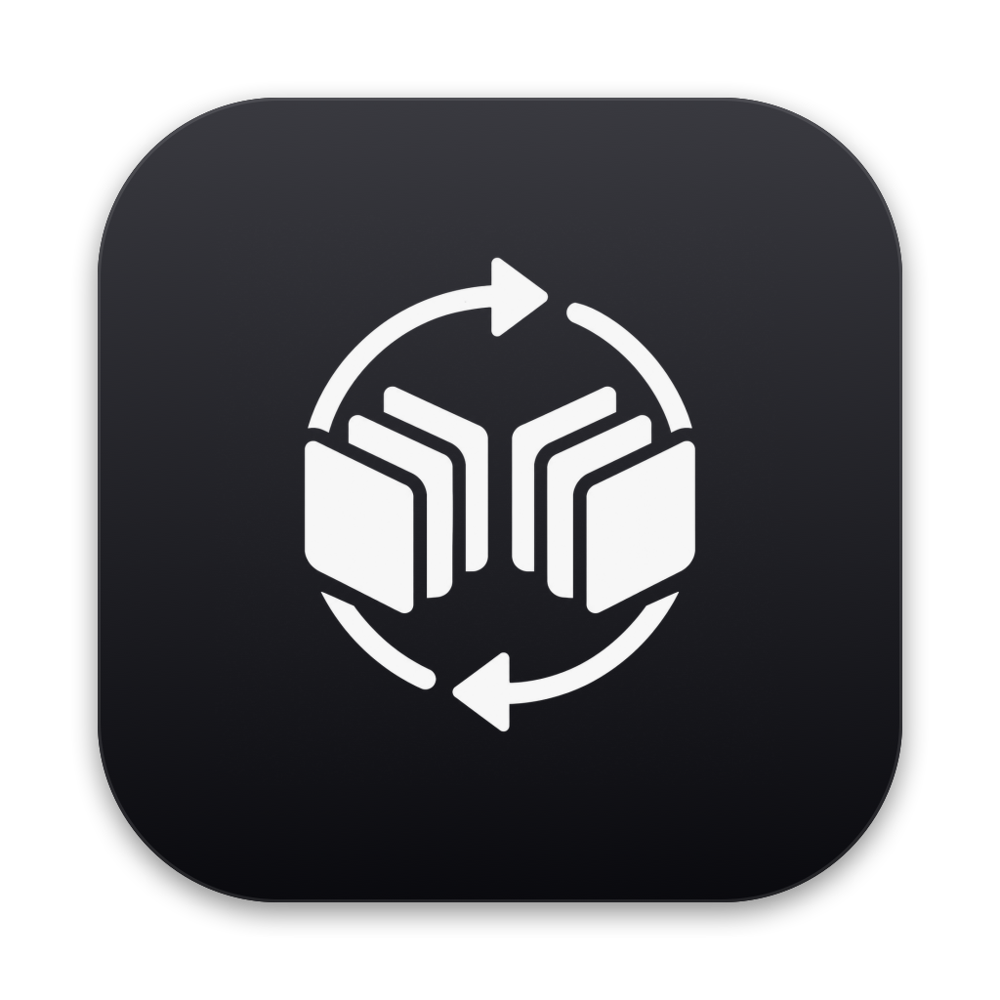

<p align="center"></p>

<h1 align="center">StackMirror</h1>

<p align="center">Schedule Substack Notes from your Mac, with a calendar of everything you have scheduled.</p>

> StackMirror is a local tool, not an official Substack client. It uses Substack's undocumented Notes endpoints.

## What it does

- **Calendar** — a month view of your scheduled Notes, read from Substack itself, so Notes scheduled elsewhere show up too. Pick a day, write a Note, choose a time, and schedule it.
- **Composer** — publish a Note now or schedule it.
- **Campaigns** — turn an article into three scheduled promotion Notes: launch, pull quote, and reminder. They appear on the calendar.
- **Analytics, Engagement, Library** — your Note performance, replies, subscriptions, and a reading list, refreshed by a weekly scan.
- **AI assistants (MCP)** — a built-in MCP server, so Claude and other assistants can plan and schedule your Notes. See [AI assistants](#ai-assistants-mcp).

Scheduled Notes are held by Substack as native scheduled drafts. StackMirror does not need to be running when they publish.

## Safety model

- Your Substack session cookie is stored only in the macOS Keychain, on this device.
- Credentials are never written to project files, app preferences, or logs.
- App state is stored at `~/Library/Application Support/StackMirror/state.json` with owner-only permissions. Unreadable state is never overwritten. See [docs/launch-recovery.md](docs/launch-recovery.md).
- StackMirror never deletes or edits your existing Substack drafts or Notes.
- No API keys, cookies, app state, or build bundles belong in Git.
- The MCP server is off by default. It cannot publish immediately, edit, or delete, and it never returns your session cookie.

## Install

1. Download `StackMirror-<version>.dmg` from [Releases](https://github.com/ifeelvoid/StackMirror/releases/latest).
2. Open it and drag **StackMirror** onto **Applications**.
3. The first time, right-click StackMirror in Applications and choose **Open**, then **Open** again.

StackMirror is ad-hoc signed, not notarized by Apple, so macOS asks once before the first launch. If macOS says the app is damaged, run this once:

```bash
xattr -dr com.apple.quarantine /Applications/StackMirror.app
```

Requires macOS 14 or later. The app runs natively on Apple Silicon and Intel.

## Build from source

Requires full Xcode (not only Command Line Tools).

```bash
./script/build_and_run.sh
```

The app bundle is written to `dist/StackMirror.app`. To package a release DMG:

```bash
./script/make_dmg.sh
```

To regenerate the app icon from the glyph in `Assets/StackMirror-AppIcon.png`:

```bash
./script/build_icon.sh
```

## Setup

1. Open StackMirror **Settings** and click **Connect Substack**. Sign in inside StackMirror; the session is saved to the Keychain.
2. Open **Calendar**. Your existing scheduled Notes load from Substack.
3. Select a day, write a Note, pick a time, and click **Schedule**.

## AI assistants (MCP)

StackMirror has a built-in [Model Context Protocol](https://modelcontextprotocol.io) server. There's nothing extra to install.

1. Open **StackMirror → Settings → AI Assistants** and turn on **Enable MCP server**.
2. Click **Add to Claude Desktop**, then quit and reopen Claude. For Claude Code, click **Copy Command** and run it. For Cursor, Windsurf, and other clients, click **Copy JSON** and paste it into the client's MCP config.

| Tool | What it does |
| --- | --- |
| `list_scheduled_notes` | Lists your scheduled Notes, live from Substack |
| `schedule_note` | Schedules a Note for a future time, using your prefix, suffix, and link-preview settings |
| `recent_note_stats` | Shows reactions, restacks, and replies on your recent Notes |

Clients start the app binary itself with `--mcp`. No window opens, and StackMirror doesn't need to be running. Keep the app in Applications, because the client stores its path. Turning the switch off stops all tool calls right away. Each client session can schedule at most 20 Notes.

## Limitations

- Substack has no documented public Notes API. Endpoints may change without notice. Use at your own risk and review Substack's terms.
- Scheduled Notes cannot yet be rescheduled or unscheduled from StackMirror. Use Substack for that.
- Link previews are created when Substack accepts the URL. A rejected preview does not block the Note text.

## Security

Read [SECURITY.md](SECURITY.md) before reporting a vulnerability.
